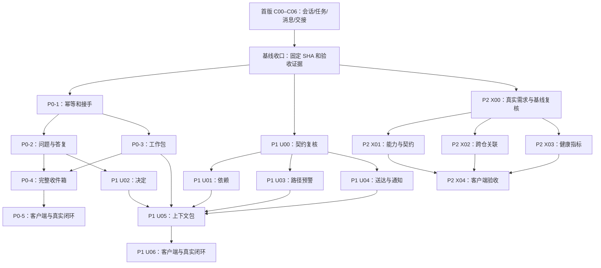

# 多 Agent 协作实施路线图：首版、P0、P1、P2

> 状态：Proposed，供排期和评审；2026-11-04。本文整合[首版设计](multi-agent-collaboration-design-2026-11.md)、[P0](agent-collaboration-p0-design-2026-11.md)、[P1](agent-collaboration-p1-design-2026-11.md)、[P2](agent-collaboration-p2-design-2026-11.md)；详细接口、数据模型和单项验收以对应设计为准。本文不表示后续阶段已经实施、通过验收或发布。

## 1. 目标与当前起点

同账号的不同 Agent 能在仓库中发现任务、沟通、交接并可追溯；后续逐步增加可靠恢复、依赖协调、跨仓权限和多客户端互通。优先保证授权、并发正确性和证据可信，再扩大自动化与适用范围。

**2026-11-04 工作区快照**：当前 HEAD `7fd3a51dbd57fca2f7dbe311433224eeafedc85c`，工作区有未提交的协作实现、测试与文档。首版[验证记录](multi-agent-collaboration-verification-2026-11.md)报告：基于该 HEAD 加当时未提交改动，SQLite/PostgreSQL 17/MySQL 8.4 的协作存储和 REST 测试通过；真实服务 + MCP + HTTP 客户端的 Git 仓库闭环仅在 SQLite 运行。它还记录全量 workspace 测试有一项 OpenAPI 处理器未登记失败、CI 未运行、多实例未验证。上述是已有验证报告的结论，本次路线整理未复跑，不证明当前工作区或某个干净提交已通过。

P0/P1/P2 均为设计提案。随着另一执行方推进，开始下一任务前重新读取 Git 状态、首版实现和验证记录，以最终合并后的代码和证据为准，不覆盖并行工作。

## 2. 阶段依赖与可并行关系

图示 X04 是 P2 全范围完成时的依赖；若只选择跨仓或健康其中一项，X04 可针对所选能力单独验收，未选能力不能标为完成。X03 还依赖其统计的首版/P0/P1 真实事件来源。U05 可分 section 提前交付；上述全部依赖用于宣称完整上下文包及完整 P1。P1 的 U01/U03/U04 可在首版基线收口后独立推进，不必等待整个 P0 完成；U02 依赖 P0 问答。P2 的 X01 可在真实互通需求确认后提前，不以全量 P1 为硬前置。

## 3. 首版收口：进入后续开发的基线

| 任务 | 工作内容 | 退出条件 |
|---|---|---|
| B0 核验 | 对照首版设计 §9 的实际偏差、工作区 diff 和验证报告，确定由谁集成当前并行改动 | C00–C06 及 T01–T12 的状态对应明确代码和证据；未验证事项明确列出 |
| B1 固定基线 | 在合适时机集成并记录可复现的干净 SHA；复跑受影响测试 | 指定 SHA 的首版测试通过；结果不再依赖无法重现的未提交工作区 |
| B2 集成门禁 | 处理或由负责方处理报告中的 `get_release_by_tag` OpenAPI 登记失败，再跑项目所需检查和 CI | workspace 必需门禁及 CI 在该基线上通过；无关问题未解决时注明影响并由项目决定是否阻塞对应交付 |
| B3 边界验收 | 复核授权、会话密钥、三后端并发、SQLite 真实闭环；明确跨实例、浏览器及其他后端真实端到端覆盖 | 首版 T01–T12 达到项目承诺的层级；跨实例、PostgreSQL/MySQL 真服务闭环等未测项不得写成通过 |

> **2026-11-04 更新**：本节快照已过时。协作首版已提交（HEAD `0005ad3`，本分支已合入 main 的 `5b96ee7`，`get_release_by_tag` 的 OpenAPI 登记已就绪）；P0 子集（O01、接手、问答、工作包、实时收件箱、O03a 预览、O04 展示）的实现与验证见 [P0 验证记录](agent-collaboration-p0-verification-2026-11.md)。可见性已决定为“写者/协作者/组织成员/所有者可读”，公开仓库的普通登录用户不再可读。

当前首版记录的实现偏差特别影响后续设计：交接接受不自动改任务负责人；协作读为已登录且具仓库读权限；仓库/用户删除通过外键级联删除协作记录；MySQL 时间精度及跨实例权限表现需实际核验。后续任务必须以最终实现为准重新评审，不把最初 Proposed 表结构当既成事实。

## 4. P0：可靠沟通与离线恢复

**阶段结果**：两个共用账号的 Agent 能发现任务、提出问题、获取人工答复、接手离线工作并查看可核对的工作包。

| 任务 | 范围 | 前置 | 任务验收 |
|---|---|---|---|
| P0-0 首版复核 | 对齐首版合并后的实体、鉴权、迁移、MCP 与验证记录 | B0–B3 的适用基线 | 已冻结首版版本、权限语义和未决项 |
| P0-1 写入与接手 | 幂等记录、版本 CAS、接手历史、人工重指派；过期/离线区分 | P0-0 | [P01–P04](agent-collaboration-p0-design-2026-11.md)；并发和响应丢失不重复、不覆盖 |
| P0-2 问答 | 问题、答复、上下文新鲜度、用户答复接口 | P0-1 幂等基础 | P05–P08；答复/取消竞争唯一终态，无法判断新鲜度返回 unknown |
| P0-3 工作包 | 不可变版本、声明与平台证据分离、引用解析 | P0-1；可与 P0-2 并行 | P09–P10；重复提交不生成额外版本，自报不冒充 CI |
| P0-4 收件箱 | 聚合任务、消息、交接、问题和答复；快照、已读与权限过滤 | P0-1–P0-3 | P11–P13；跨页、撤权、超限和失效均可解释 |
| P0-5 接入与闭环 | MCP、人工 UI 或等价客户端、OpenAPI、文档及真实运行 | P0-1–P0-4 | P14–P15；真实服务、Git 仓库、两种客户端与用户答复 |

P0-1 后可提前交付只覆盖已有任务/消息/交接的收件箱子集；必须声明所支持类型，不称为完整 P0 收件箱。

**P0 阶段门**：P01–P15 全部在适用环境通过；核心迁移与并发在三数据库验证；真实双客户端中途断线/接手/人工答复/工作包闭环有记录；权限、密钥、快照和幂等门禁通过。没有真实人工入口或真实客户端证据时只能标注部分完成。

## 5. P1：减少协调等待与上下文损失

**阶段结果**：Agent 能看到任务依赖与路径重叠、区分送达和答复、追溯决定，并在有限预算内恢复上下文。

| 任务 | 范围 | 前置 | 任务验收 |
|---|---|---|---|
| U00 契约复核 | 冻结首版和相关 P0 的认证、事务、交接与分页 | 首版基线；对应 P0 模型定稿 | 映射实际实现和提案差异 |
| U01 任务依赖 | 图版本并发控制、防循环、依赖状态与提醒 | U00 | [N01–N03](agent-collaboration-p1-design-2026-11.md)；多后端并发不成环 |
| U02 决定追溯 | 不可变决定及替代/撤销、来源与新鲜度 | U00 + P0-2 | N04–N05；单终态、历史可查 |
| U03 路径预警 | 独立声明时间、路径边界匹配和不确定性 | U00；可与 U01/U02 并行 | N06–N07；提示不阻塞 Git 写入 |
| U04 送达与交接 | 逐条回执、持久提醒、交接历史 | U00 | N08–N10；已读不等于同意，提醒和业务状态可靠关联 |
| U05 上下文包 | 按字节预算返回任务、待答事项、决定、交接与来源 | 对应 P0 快照和工作包、实际纳入的 U01–U04 字段 | N11–N12；DB 快照和 Git 独立观测有标注，截断可恢复 |
| U06 接入与闭环 | MCP、客户端、人工界面和真实双客户端流程 | 完整范围依赖 U01–U05 | N13–N14；权限、密钥、出处和真实接续通过 |

**P1 阶段门**：N01–N14 通过；防环、回执与通知的并发/故障测试在三数据库分别通过；真实客户端能围绕依赖、交接和决定接力。单个 section 可先发布，但只声明其实际支持范围。

## 6. P2：按需求扩展跨仓、健康与互通

**阶段结果**：在同一实例内安全关联多仓工作、解释协作状态，并让不同 harness 依据版本化契约接力。每项按真实需求独立立项。

| 任务 | 范围 | 前置 | 任务验收 |
|---|---|---|---|
| X00 场景与基线 | 收集真实跨仓/互通需求，复核首版、P0/P1 合并契约 | 已有可用首版基线 | 明确所选 P2 能力和真实验收环境 |
| X01 能力与兼容 | REST 能力发现、MCP 工具/schema 对齐、版本和降级策略 | X00 | [M10–M11](agent-collaboration-p2-design-2026-11.md)；不广告未启用能力 |
| X02 跨仓关联 | 锚仓 group、逐仓权限、可见结果分页、仓库生命周期 | X00；可与 X01 并行 | M01–M05；不可泄露无权仓库和隐藏数量 |
| X03 协作健康 | 事务内事件、指标口径、覆盖率和单仓钻取 | X00 + 对应业务事件来源 | M06–M09；缺失历史标记 partial/unknown，不给 Agent 排名 |
| X04 真实互通 | 客户端样例与双客户端、双仓真实运行 | X01 + 选定的 X02/X03 | 所选能力的验收及 M12；不能复用旧会话密钥或未授权数据 |

**P2 阶段门**：只有同时选择并完成 X01–X04，且 M01–M12 全部通过，才称为完整 P2；按能力单独交付时逐项报告。跨实例、三数据库、真实双仓与两种客户端的适用测试缺一项即标为未验证，不用模拟通过替代。

## 7. 新增横向需求：O01–O10

详细行为、候选接口、数据边界及验收见[协作规则、用户总览、恢复与完成条件](agent-collaboration-operability-requirements-2026-11.md)。这些任务并入下列阶段，可与既有任务按依赖并行；不得把设计提案标成已实现。

| 任务 | 优先级与安排 | 依赖 | 退出条件 |
|---|---|---|---|
| O01 规则入口 | P0；首版基线后并行 | Git 按 SHA 读取、仓库读权限 | 规则发现、适用范围、commit/blob 版本、分页和撤权通过 O01 四项验收；来源不提升为系统指令 |
| O02 用户总览 | P0；先首版子集，后接完整 P0 | 首版任务/会话/交接；完整问答依赖 P0-2/P0-4 | 真实用户能发现并处理待决事项；分 section 标明版本与权限；通过 O02 验收 |
| O03a 保留现状审计 | P0；B0 后优先 | 现有删除、备份与三数据库链路事实 | 删除影响、覆盖范围、保留和未验证项可追溯；不执行生产恢复 |
| O03b 预览与恢复 | P0 分期；按护栏及隔离环境推进 | O03a；版本化数据模型和实际备份入口 | 预览失效、真实隔离恢复、Git/DB 一致性、无外发副作用及各适用后端通过 O03 验收 |
| O04 完成条件 | P1；先展示，再评估强制模式 | 首版任务；问答依赖 P0-2、工作包依赖 P0-3、CI 条件依赖 SHA 绑定证据 | 声明与证据分开，旧 SHA/过期答复不可误判，通过 O04 验收；强制模式另行评审 |
| O05–O07 通知升级/模板/能力声明 | P1，按价值独立立项 | U04 通知、首版任务/会话、O01 规则版本 | 去重及权限、模板版本固定、自报不可授权，分别通过需求文档验收 |
| O08–O10 预算/搜索/诊断 | P1–P2，按实际需求立项 | 对应 harness 度量、可搜索对象、通知状态 | 数据来源和缺失清晰，搜索权限不泄漏，诊断不伪造原因 |

**扩展阶段门**：对外宣称完整 P0 用户闭环时，O01、O02 与 O03a 的适用验收应通过；O03b 如未完成，明确标记恢复能力未验证，不能声称已具备可恢复保障。宣称包含完成条件的 P1 时，O04 的适用验收须通过；O05–O10 只有明确纳入交付范围时才是对应阶段门。

## 8. 横向门槛与证据

每个任务在开发前确定目标 SHA、依赖版本、迁移与权限影响；新增迁移、认证或其他受项目护栏约束的操作遵循 [.ai/guardrails.md](../../.ai/guardrails.md)。不得修改已执行迁移。保持不同任务的边界，避免覆盖同一工作区中其他 Agent 的改动。

| 门槛 | 各阶段必须证明 |
|---|---|
| 身份与权限 | 每次请求重新鉴权；会话标签不当可信身份；跨仓逐仓检查；撤权延迟与缓存行为按实际部署记录 |
| 数据与并发 | SQLite/PostgreSQL/MySQL 的迁移、约束、并发、故障恢复分别验证；CAS、幂等和消息顺序以数据库事务保障 |
| 信息与密钥 | 会话密钥不出现在工具结果、日志或审计；外部内容不自动执行；声明与验证证据分离 |
| 版本与恢复 | 快照、游标和上下文标记版本；过期/重试/部分成功有明确结果；不以时间戳或自增 ID 推断提交顺序 |
| 客户端契约 | REST、MCP 和实际人工入口在字段、错误和授权语义上可对照；不兼容变化有版本化方案 |
| 真实任务 | 使用真实 Git 仓库、服务及目标客户端执行阶段闭环；仿真只能补充故障测试，不能冒充真实运行 |

记录每项任务的 **实现证据 → 任务验证 → 合并后集成验证 → 真实运行 → 远端/发布验证**：包含目标 SHA、工作区状态、测试命令、数据库/服务/客户端版本、结果、日志位置和未验证项。前一层不能替代后一层。任一硬门槛失败或不可执行时，阶段标注未通过/待验证并说明原因，不以数量或平均成功率抵扣。

## 9. 排期前需要决定

1. 首版协作数据对仓库读者的可见范围；P0–P2 设计暂沿用首版读权限方案，若收紧须同步重新评审。
2. P0 用户决策以 Web 为主还是等价人工客户端优先；完整验收必须有真实人工操作入口。
3. P2 是否先做跨仓、指标或互通；数据保留期限、指标可见人群和 API 兼容窗口需在相关实施前确定。
4. 若阶段设计与最终实现冲突，以代码和运行证据作为现状，以评审通过的契约为目标；先更新设计与本路线，再据此实施。

5. 规则发现默认范围、备份保留策略与恢复目标、完成条件是否允许强制执行，须分别评审后确定。
