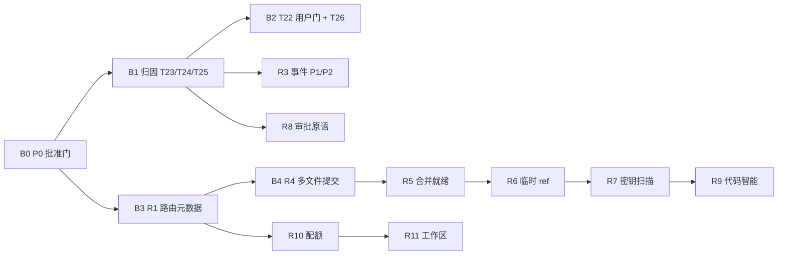

# Agent 主体身份与 agent 友好化路线图（v2 细化版，2026-11-10）

> **状态**：第一期已合 main（PR #47，merge `063e6eb`；`feat/agent-principals` 现为 main 祖先，`git rev-list --count cnb/main..cnb/feat/agent-principals` = 0）；§3 的 P0 已落地（PR #22，`0fe75a5`）；第二期与路线图**未开工**
> **本版性质**：v1 的细化 + 更正。v1 中标为"推测"的判断已逐条读码核实，**发现 10 处需要更正**，其中 1 处是安全缺口（§3）。v1 原文：`git show 979caab:ironforge-docs/architecture/agent-principals-design-and-roadmap-2026-11.md`
> **可信度**：第一期为"实现 + 单元测试"级；第二期与路线图为**设计**，触点带 `文件:行`，未写一行实现代码
> **阅读顺序**：§0 变更摘要 → §2 现状（含不变量）→ §3 P0 → §4 第二期任务卡 → §5 路线图任务卡 → §6 批次与依赖。动手前读 §7

---

## 0. v2 相对 v1 的变更摘要

| # | v1 的说法 | 核实结果 | 影响 |
|---|---|---|---|
| 1 | agent 不能批准 PR，靠 `ensure_session_may_approve` | **不成立**。该函数判的是"令牌是否带分支白名单"（`ref_allowlist.is_some()`），与 `users.kind` 无关；且只在请求带 Bearer 时调用。**agent 只要签发时不传 `refs`，就能批准任何非自己的 PR——包括其所有者的 PR** | 升级为 P0，见 §3 |
| 2 | agent 的批准"默认不计入"必需批准数 | **v2 时点未实现，现已修**。原 `count_approvals`（`pr_review_ops.rs:46`）不区分账号类型，现为 `count_current_human_approvals`（`:57`）只数人类 | §3 已落地 |
| 3 | 协作用"有没有会话头"区分人与 agent，agent 不带头就能冒充人 | **部分成立**：确实只按头判断，但全仓 `collab*.rs` 无任何 `kind` 判断，agent 走用户门并不"冒充"，只是被记为 `Actor::user`。真正的问题是语义被写成"人" | §4 T22 |
| 4 | `required_pat_scope` 漏登记即越权 | **不成立**。它是前缀判定函数（不是表），默认返回 `admin`，**fail-closed**（`lib.rs:2043-2052` 注释明确说旧版 catch-all 才是漏洞，已修）。真实风险变成：`path_in_allowlist` 对名单内仓库的新路由**默认放行**（fail-open），且没有"所有路由都登记了 scope"的守卫测试 | §5 R1 改写 |
| 5 | 事件日志"尽力而为写入" | **准确**，但比 v1 更弱：`repo_events` 写入在 `spawn_post_push_hooks` 派生的任务里、业务提交之后，失败只 `tracing::warn`；webhook 无 schema 版本、无事件头，接收方 5xx **不重试**（只有传输错误入队） | §5 R3 补事实 |
| 6 | `contents` 写是单文件，需新增多文件提交 | **准确**，但 v1 漏了已有原语：`commit_tree_edits` + `update_files_in_commit` 已能一次改多文件。限制是 `expected_blob_sha` 必填、**不能新建文件**、不暴露删除 | §5 R4 从"新建"降为"扩展现有" |
| 7 | 三套审批机制"相似，可抽象成一个原语" | **只在表面成立**：CI 环境审批是 N-of-M + 唯一约束；协作问题是单次作答 + 版本 + context_hash；完成条件确认明确写着 "display only, nothing here blocks" | §5 R8 缩范围 |
| 8 | 检索"只有 SQLite FTS5" | **部分准确**：是跨后端 FTS 抽象（SQLite FTS5 / PG tsvector / MySQL FULLTEXT） | §5 R9 表述修正 |
| 9 | agent 的 SSH 密钥"不支持" | 准确，且已有一半护栏：`rg-ssh` 密码分支显式拒绝 agent（`rg-ssh/src/lib.rs:350`），添加公钥入口先 `ensure_human`（`ssh_keys.rs:103`）。SSH 认证还查 deploy key，不是只查 `ssh_keys` | 无改动，补事实 |
| 10 | CLAUDE.md 有"新增路由必须同步"的编号条目 | 4 处提醒都在 `CLAUDE.md:161/163` 的表格行；踩坑第 13 条是迁移表名，第 20 条是 `src/api/*.rs` 不递归 | §7 修正引用 |

---

## 1. 背景与目标（保留 v1 结论）

IronForge 的目标是 agent 友好、可自部署的 Git 服务端。现有 agent 能力（PAT scope 阶梯、仓库/分支白名单、幂等键、事件日志、协作工具、MCP stdio 与 streamable HTTP）已经很多，但**身份模型仍是"人"**：

- `access_tokens`、`ssh_keys`、`agent_sessions`、`audit_log` 全部只挂 `user_id`；
- PAT 换出的是令牌所有者的完整会话 JWT，只多一个 `tid`；
- 评审的自批检查是 `pr.author_id == user_id`（`api/reviews.rs:325`），agent 借人的账号开 PR 就会把这个人锁在批准之外。

第一期把"agent 是谁、代表谁、最多能做什么"建成一等概念。第二期要让"agent 做的事"在评审、审计、通知、提交历史里都能被正确归因。路线图解决的是更外层的 agent 写作体验。

---

## 2. 第一期现状（分支 `feat/agent-principals`，已合 main）

### 2.1 数据模型

迁移 `m20261110_000001_add_user_kind_and_owner`（`up` 幂等、`down` 空）给 `users` 加三列 + 一个索引：

| 列 | 类型 | 含义 |
|---|---|---|
| `kind` | `VARCHAR(16) NOT NULL DEFAULT 'human'` | `human`（所有旧行）或 `agent` |
| `owner_user_id` | `BIGINT NULL` | agent 的所有者（人类账号）；人类为 NULL。**无外键**，由应用层保证 |
| `agent_description` | `TEXT NULL` | 用途说明，仅展示 |
| `idx_users_owner_user_id` | 索引 | 按所有者列 agent |

agent **就是 `users` 里的一行**，没有单独的表。原因：一百来个实体的作者、评论者、协作者字段和 `can_read/can_write` 都以用户 id 为键，另建主体表意味着处处多态。代价是必须关死所有"人类入口"（不变量 1）。

### 2.2 核心代码地图

| 关注点 | 位置 |
|---|---|
| 业务逻辑 | `rg-core/src/agent.rs`：`create_agent`/`list_agents`/`update_agent`/`find_owned_agent`、`ensure_human`、`owner_cap`/`OwnerCap`、`validate_agent_token_scopes`、`is_reserved_username`、`is_agent`（:48） |
| HTTP | `rg-http/src/api/agents.rs`：`/agents`、`/agents/{username}`、`/agents/{username}/tokens[/{id}]`；令牌签发复用 `users::issue_token(.., for_agent = true)`；创建/撤销令牌的审计记在**所有者**名下（`user_id = owner_id`，action `agent.token.*`） |
| 权限上限 | `rg-core/src/repo/service.rs::apply_owner_cap`，被 `can_read_repo`/`can_write_repo` 调用；`can_admin_repo` 对 agent 恒 false |
| 用户名 | `<所有者>-agent-<名字>`，名字 1–20 位字母数字/`-`/`_`。人类用户名与组织名禁止含 `-agent-`（`rg-core/src/lib.rs` 与 `user/service.rs` 两个 `validate_username`）；创建时也拒绝与已有组织同名 |
| 邮箱 | 合成 `agent-<uuid>@agents.invalid`（`agent.rs:169`），不可读 → T25 改为由用户名派生 |
| 停用 | `is_active=false` + `token_version += 1` |

### 2.3 不变量（改动时必须保持）

1. **agent 没有人类入口。** `auth_provider = "agent"`、`password_hash = "!"`（不是哈希）、邮箱在 `@agents.invalid`。已显式拒绝：密码登录、密码重置、SSO 按邮箱匹配、SSH 密码、添加 SSH 公钥、`update_user_admin` 设管理员、创建 PAT 的普通入口。**新增任何登录方式必须同步拒绝 agent，并加进 `an_agent_has_no_human_entrance`。**
2. **agent 令牌只能带仓库类 scope**（默认 `repo:write`），所以进不了 `/users`、`/agents`、`/admin`（`required_pat_scope` 里 `/agents` 归 `user` scope）。
3. **权限 = agent 自己的授权 ∩ 所有者当前的权限。** 所有者不存在、被停用、或不是人类 → 一律拒绝（`owner_cap`）。agent 永不管理仓库。
4. **agent 的判权结果不进 30 秒权限缓存**（`apply_owner_cap` 返回 `cacheable=false`）；所有者一侧走所有者自己的缓存项。原因：现有失效调用点指向所有者的 `(repo, user)`，缓存 agent 的"是"会让撤权延迟 30 秒。
5. **agent 什么都不拥有**：`ensure_human` 守住创建仓库、fork、转移（两端）、创建组织。名下有 agent 的账号不能被删除（409）。
6. **停用 agent** = 令牌被拒 + 已换出的会话立即失效；重新启用后同一令牌恢复；停用状态下不能签发新令牌（409）。
7. 别人的 agent 与不存在的 agent 对调用者一律 404；`/agents` 只有人类能调用。
8. **评审：agent 一律不能批准**（v2 新增，来源 §3）。批准权由**账号类型**决定，不由令牌形态决定；所有者可以批准自己 agent 的 PR，且**计入**必需批准数。
9. **协作写入：agent 必须带 collab session**（v2 新增，来源 T22）。用户门是"人 / CLI 替人说话"的入口，agent 不得使用。**本条已强制（issue #34，2026-11-12）**：`write_actor` 在无会话头时查账号类型，agent 得 403，`reason = AGENT_MUST_USE_SESSION`；`confirm_condition`（`AGENT_MAY_NOT_CONFIRM`，带会话也不行）与 `reassign_task`（`AGENT_MAY_NOT_REASSIGN`）同样只允许人。**例外**：`PUT …/inbox/user/read`（`mark_user_read`）按 T22 原方案保留，agent 仍可调用——它只写"已读"标记、不改任何问题/交接/任务状态；是否也收紧是待裁决项（R34-2）。读不受限。证据见 [collab-agent-gate-verification-2026-11.md](collab-agent-gate-verification-2026-11.md)。

### 2.4 验证证据（v1 原样保留）

| 命令 | 结果 |
|---|---|
| `cargo clippy --workspace --all-targets -- -D warnings` | 无告警 |
| `cargo test -p rg-http --test agent_principal_tests` | 8 项通过（SQLite） |
| `cargo test -p rg-db` | 通过，含迁移回滚后重放 |
| `cargo test -p rg-http -p rg-core -p rg-ssh -p rg-mcp --no-fail-fast` | 128 个测试目标通过；`collab_session_tests::t02_...` 曾失败一次（"control: cache should still be warm"），重跑 3+3 次通过 |

关于那次失败，**推测**为既有的跨测试缓存碰撞（权限缓存是进程级、按 `(repo_id, user_id)` 记，测试各库 id 会撞），**未在 main 上对照复现**。若 CI 反复出现，先 `git worktree` 在 main 上重复跑该目标。`agent_principal_tests` 用一把静态锁串行化并在每个测试开头清缓存，就是为避开同类问题。

**没跑过**：PostgreSQL、MySQL；前端；真实 MCP 客户端；真实 git push 的 agent 路径（只测了 REST 文件提交作为写判权代表）。

### 2.5 第一期遗留缺口（核实后分级）

| 级别 | 缺口 | 处置 |
|---|---|---|
| **P0** | agent 可批准 PR（不带 `refs` 的 agent 令牌）；批准计数不过滤账号类型 | §3，**已修**（PR #22 `0fe75a5`）+ 同一缺口的第二处：CI 受保护环境的批准人名单（`ci_environments.rs:88`/`:289`）同批修 |
| P1 | 协作用户门不区分 `kind`；审计无 `on_behalf_of`；通知不认 agent；提交作者是 agent 的 `.invalid` uuid 邮箱 | §4 T22–T25 |
| P1 | `path_in_allowlist` 对名单内仓库的新路由默认放行 | §5 R1 |
| P2 | 绕过 `can_*_repo` 的判权点（直接查协作者表/组织成员表）**未逐一排查**；起点 `grep -rn 'repo_collaborator_ops::get_permission\|is_org_member\|find_org_member' crates` | 排进 R1 验收项 |
| P2 | `MAX_AGENTS_PER_OWNER = 50` 是拍脑袋值 | 观察，不做 |
| P2 | agent 的 `.invalid` 邮箱是否会被邮件路径发信 —— **已核实为否**（CI 通知取 `repo.owner_id`，而 `create_repo` 有 `ensure_human`；密码重置 `:711` 拒 agent） | 结案，不加收件人过滤 |
| P2 | 旧问题、与本期无关：SSH 密码不检查 `is_active`；协作者接口改权限按协作者行 id、删除按用户 id 寻址，删错 id 也返回成功 | 单独 issue，不混进来 |

---

## 3. P0：批准门失效（已修，PR #22 `0fe75a5`）

> **阅读提示**：§3.1/§3.2 是**修前**的记录，其中的代码段与行号属历史形态——`ensure_session_may_approve` 已不存在，批准路径的判权段现为 `reviews.rs:325-341`（`:305` 是 `submit_review` 的签名行，判权段在其后），门函数在 `auth.rs:165`（原记 `:155`，那是修前位置）。§3.3 起是**已落地的形态**。

### 3.1 缺口

`api/reviews.rs:305` 的批准路径有两道门，都挡不住 agent：

```rust
// 门 1：只挡"批准自己的 PR"
if matches!(action.as_str(), "approve" | "request_changes") && pr.author_id == user_id { ... }

// 门 2：只在带 Bearer 时执行，且判据是"令牌有分支白名单"
if should_attempt_auto_merge {
    if let Some(claims) = crate::api::auth::extract_bearer_claims(&headers, &state.jwt_secret) {
        if let Err(e) = crate::api::auth::ensure_session_may_approve(&state.db, &claims).await { ... }
```

`ensure_session_may_approve`（`api/auth.rs:155`）只做一件事：`session_access_token(...).ref_allowlist.is_some()` → 403。注释写着 "A token limited to some branches is an agent's token"，即**用令牌形态代理账号类型**；而 `POST /agents/{username}/tokens` 的 `refs` 是可选字段（`CreateTokenRequest.refs: Option`）。

### 3.2 复现（三条，全 REST）

1. 人 A 创建 agent `A-agent-bot`，签一把**不带 `refs`** 的 `repo:write` 令牌。
2. 人 A 用自己账号开 PR `#1`（分支保护要求 1 个批准）。
3. `A-agent-bot` 用该令牌 `POST /repos/{o}/{r}/pulls/1/reviews {"action":"approve"}` → 门 1 比的是 agent id ≠ A 的 id，门 2 因无 `ref_allowlist` 放行 → **批准成功且计入必需批准数**，A 合并。

等价后果：任何有所有者的 agent 都能替所有者完成"自批"，分支保护对"单人 + agent"组合形同失效。

### 3.3 修法（函数级）

**(a) 判定改为账号类型，且不再依赖请求带 Bearer**（`api/auth.rs`）

```rust
/// Approving is a human act. An agent's approval never satisfies a review
/// requirement, whatever shape its credential is.
pub(crate) async fn ensure_reviewer_may_approve(
    db: &sea_orm::DatabaseConnection,
    user_id: i64,
    claims: Option<&Claims>,
) -> Result<(), AppError> {
    let Some(user) = rg_db::ops::user_ops::find_by_id(db, user_id).await? else {
        return Err(AppError::forbidden("no such account"));
    };
    if rg_core::agent::is_agent(&user) {
        return Err(AppError::forbidden("an agent may not approve a pull request"));
    }
    // 旧规则保留为第二道：分支受限的令牌不能批准。
    if let Some(claims) = claims {
        if session_access_token(db, claims).await?.is_some_and(|t| t.ref_allowlist.is_some()) {
            return Err(AppError::forbidden(
                "an access token limited to some branches may not approve a pull request"));
        }
    }
    Ok(())
}
```

调用点（`reviews.rs:332-339`）改为无条件执行，去掉 `extract_bearer_claims` 前置：

```rust
if should_attempt_auto_merge {
    let claims = crate::api::auth::extract_bearer_claims(&headers, &state.jwt_secret);
    if let Err(e) = crate::api::auth::ensure_reviewer_may_approve(
        &state.db, user_id, claims.as_ref()).await {
        return e.into_response();
    }
}
```

> **落地形态（与上面的草稿有两处差别）**：①`AppError::forbidden` 不带 `reason`，而 T20-1 要断言 `reason`，所以实际用的是 `AppError::coded(StatusCode::FORBIDDEN, "FORBIDDEN", …)` + `.with_reason(AGENT_MAY_NOT_APPROVE, false, "ask a person to review and approve")`，稳定码由 `auth.rs:156` 的常量提供；②查不到账号时 `ok_or_else` 直接返回 403 而不是放行——「读不出账号」不能读成「不是 agent」，那正是本节要关掉的那条路。

**(b) 批准计数只算人类**（`rg-db/src/ops/pr_review_ops.rs:57`）

保留现有语义（按 reviewer 去重、只看当前 `head_sha`、`request_changes` 覆盖 `approve`），增加 `users.kind = 'human'` 过滤。**落地形态不是 `find_also_related`**：先 `list_by_pr` 取全量评审、在内存里按 reviewer 留最新一条、只留当前 head 的 `approve`，再对这批 reviewer id 发**一条** `users` 查询（`Id.is_in(ids)` + `Kind.eq("human")`），最后按人类集合过滤计数——即 2 次查询，不随 reviewer 数增长，也不引入 join（`pr_review_ops.rs:57-98`）：

```rust
let reviews = list_by_pr(db, pr_id).await?;          // 1 次
// ……HashMap 按 reviewer_id 留最新一条 + 只算当前 head 的 approve
let humans: Vec<i64> = user::Entity::find()          // 1 次，IN 查询
    .filter(user::Column::Id.is_in(reviewer_ids))
    .filter(user::Column::Kind.eq(KIND_HUMAN))
    .all(db).await?…;
```

函数改名 `count_current_human_approvals`，调用点同步：`branch_protection/service.rs:457`、`review/service.rs:634`。旧的 `count_approvals`（`pr_review_ops.rs:46`）**保留为委托别名**（`count_current_human_approvals(db, pr_id, None)`），本仓已无生产调用点，但它是 `rg-db` 的公开 `ops` 入口。**不加开关**；等真有人要"agent 批准也计数"再加分支保护列 `count_agent_approvals`。

**(c) 导入路径**：`import/service.rs:938-969` 直接写 `pr_reviews`，把源平台的 `"APPROVED"` 落成 `"approve"`，绕过 (a)。(b) 已在计数层过滤，这里不额外拦截；只在导入时对解析成 agent 的 reviewer 打 warn 日志，避免"导入了却不计数"无人知晓。

**(d) 不动 `dismiss`**：现有 `dismiss` 既不覆盖也不删除已计批准（`pr_review_ops.rs:63-68` 只把 `approve`/`request_changes` 放进 `latest`）。这是既有行为，改它属于另一件事。

### 3.4 测试（追加到 `crates/rg-http/tests/agent_principal_tests.rs`）

| 编号 | 用例 | 期望 |
|---|---|---|
| T20-1 | 不带 `refs` 的 agent 令牌 approve 他人 PR | 403，`reason = AGENT_MAY_NOT_APPROVE` |
| T20-2 | 带 `refs` 的 agent 令牌 approve | 403（旧行为不回退） |
| T20-3 | agent approve 其所有者开的 PR | 403 |
| T20-4 | agent approve 同所有者另一 agent 的 PR | 403 |
| T20-5 | agent comment / request_changes | 允许（不变量只限批准） |
| T20-6 | 人用 cookie 会话 approve | 允许（门不再依赖 Bearer） |
| T20-7 | agent approve 后分支保护仍要求 1 个批准 | 合并 403 |
| T20-8 | 所有者 approve 自己 agent 的 PR | 允许，计入必需数 → 合并成功 |
| T20-9 | 人类批准 + agent 批准并存 | 计数 = 1 |
| T20-10 | 把 agent 写进受保护环境的批准人名单 | 400（`ci_environments.rs:88`） |
| T20-11 | 规则生效前就写在名单里的 agent（或手工塞进库）去 release | 403，`count_approvals` = 0，且名单换成人后同一端点仍放行 |

> **T20-10 / T20-11 的由来**：§3 只覆盖 PR 批准，同一份代码里还有一道同样失效的门——CI 受保护环境。写名单时（`ci_environments.rs:88`）只校验 id 存在，`approve` 的判权是 `is_admin || allowed.contains(actor_id)`，而 agent 的 `can_admin_repo` 恒 false ⇒ 只要进名单，它的批准就让 `count_approvals` 达标并放行（`:289` 是计数前的第二道判定，兜住规则生效前写下的名单）。
>
> **T20-11 断言的强度有限**：agent 用默认 `repo:write` 令牌打这个端点时，**更早的 scope 中间件**先返回 403，所以这条测试断言的是**结果**（403 + 计数 0 + 人名在册时放行），不是「哪道门挡的」。把 `:289` 的账号类型判定去掉，T20-11 仍会通过——这不代表该判定无效（有令牌形态能走到 handler），但它没有被这条测试单独证明。

### 3.5 落地顺序（已执行）

单独分支 `fix/agent-approval-gate`，从 `cba96ba` 切出（依赖第一期的 `is_agent` 与 `kind` 列）；PR #22 已合入 main，`0fe75a5` 是落地提交。原文的约束「**若第一期先合 main，本修复必须同批合入**，不能留窗口期」按实际情况兑现为：第一期由 PR #47（`063e6eb`）合入，本修复在 PR #22 同批跟上，`cba96ba` 现为 main 的祖先（独有提交 0），无窗口期。**分支 ref 本身也已废弃**：tip `c882d40` 同样没有独有提交（`<你的 main ref>..c882d40` = 0——`c882d40` 本身是 main 的祖先，有 main 就有它，无需另外 fetch 该分支），但**落后 main 112 个提交**（`bd7eb84` 时点快照 = 112；规则是 `main` 每多一个提交该数 +1 ⇒ `aae47d8` 113 / `2ce6d94` 114 / `6e3a205` 116 只是**抽样点、不是逐点枚举**（115 等中间点未列）；**只增不减**，别拿当前 main 复算去对账）——一个只看名字的人会以为它还能切上去干活，实际要重新从 main 切分支。同批还有两条同型僵尸 ref（无独有提交，同为 `bd7eb84` 时点）：`fix/oci-token-visibility`（`43e3092`，落后 87）、`fix/password-strength-bypass`（`79c6b62`，落后 87）。

---

## 4. 第二期细化（T21–T26）

完成口径统一：`cargo clippy --workspace --all-targets -- -D warnings` 干净 + 新测试全绿 + 新 SQL 至少跨后端跑一次（`IRONFORGE_TEST_DATABASE_URL`）+ 不动 §2.3 的不变量。

| ID | 任务 | 触点文件数 | 规模 | 依赖 |
|---|---|---|---|---|
| T21 | 评审规则 | 4 | S | 第一期 |
| T22 | 协作用户门要求 `kind = human` | 9 | M | 第一期（✅ 2026-11-12，issue #34；`mark_user_read` 保留为例外） |
| T23 | 审计 `on_behalf_of_user_id` | 6 | M | 第一期 |
| T24 | 通知改派给所有者 | 3 | M | 无 |
| T25 | 提交作者与推送者归因 | 3 | S | 第一期 |
| T26 | 响应携带主体类型 | 8 | L | T23/T25 |

---

### T21 评审规则

见 §3。**已定默认**：agent 一律不可批准；所有者批准自己 agent 的 PR **计入**必需批准数（否则单人仓库无法合并 agent 的 PR）；更严的场景等 `count_agent_approvals` 列再说。

---

### T22 协作用户门要求 `kind = human`

**目标**：`write_actor` 的"用户门"分支只服务人类；agent 写协作数据必须带 collab session。

**现状（核实）**：`api/collab.rs:94-109`

```rust
if headers.contains_key(HEADER_SESSION) || headers.contains_key(HEADER_SESSION_SECRET) {
    Ok(Actor::session(session.id))
} else {
    Ok(Actor::user(user_id))          // 无 kind 判断
}
```

`Actor { kind: &'static str }` 取值只有 `"session"` / `"user"`（`rg-core/src/collaboration/mod.rs:72-94`）。全仓 `collab*.rs` **零处** `users.kind` 判断。`write_actor` 有 15 个调用点，分布在 `collab_budgets` / `conditions` / `decisions` / `dependencies` / `groups` / `questions` / `work_packages` 七个文件。

**方案**：`else` 分支前查一次账号类型，agent 直接 403；拒绝要带机器可读 reason（`AppError::coded(FORBIDDEN, "FORBIDDEN", …).with_reason(AGENT_MUST_USE_SESSION, …)`，写法照 `api/auth.rs::ensure_reviewer_may_approve`），`ensure_human` 只有自由文本、拿不到稳定 reason。

```rust
pub(crate) async fn write_actor(
    state: &AppState, headers: &HeaderMap, repo_id: i64, user_id: i64,
) -> Result<rg_core::collaboration::Actor, AppError> {
    if headers.contains_key(HEADER_SESSION) || headers.contains_key(HEADER_SESSION_SECRET) {
        let session = acting_session(state, headers, repo_id, user_id).await?;
        return Ok(rg_core::collaboration::Actor::session(session.id));
    }
    if rg_core::agent::is_agent(&rg_db::ops::user_ops::find_by_id(&state.db, user_id).await?.ok_or_else(|| AppError::forbidden("no such account"))?) {
        return Err(AppError::forbidden(
            "an agent must act through a collaboration session, not the user door"));
    }
    Ok(rg_core::collaboration::Actor::user(user_id))
}
```

要点：

- **只拦写**。`require_collab_read` 的路径不动，agent 仍可读。
- **不新增 `Actor::agent` 变体**。"用户门"语义是"替人说话"，agent 用它是错的，不是"换一种身份"。加变体会连带改 capabilities 契约、审计口径与前端。
- **显式强制用户门的端点**单独处理：`collab_inbox.rs` 的 `PUT …/inbox/user/read` 保留（无害读标记）；`collab_conditions.rs::confirm_condition`（:178）是"人作出的确认"，加 `ensure_human`。
- 每次协作写多一次 `users` 查询。协作写本来就查库判权（`require_collab_write` 每次都清缓存 + `can_write_repo`），成本可忽略；要省可在 `AppState` 加短 TTL 的 `kind` 缓存，**但不要塞进权限缓存**（不变量 4）。

**测试**：agent 令牌无会话头做任一协作写 → 403 `AGENT_MUST_USE_SESSION`；带正确会话头 → 200；人类无会话头 → 200（回归）；agent 对 `confirm_condition` → 403；agent 读协作数据 → 200。

**风险**：15 个调用点里若有"agent 不带会话也能写"的既有假设，会立刻暴露；先跑现有协作测试。**规模** M（0.5–1 天）。

---

### T23 审计 `on_behalf_of_user_id`

**目标**：审计能回答"这条是哪个 agent 代表谁做的"，且可索引。

**现状（核实）**：`api/audit.rs:324-356`（文档注释自 `:317` 起）的 `record_write` 写 `user_id / username / action / resource_type / resource_id / resource_name / ip_address / user_agent / details / created_at`，**fire-and-forget**（失败只 `tracing::error!`，`:353-355`）。`with_access_token`（`:369-391`）把 `access_token_id` 塞进 `details`（键名 `:389`），所以"用了哪把令牌"可查；"代表谁"要 join `users.owner_user_id` 才知道，**不能直接按 owner 过滤**——本项就是把这次 join 变成一个可索引的列。

**数据模型**：

```rust
// m20261110_000002_add_audit_on_behalf_of
// up: has_column / has_index 守卫；down: 空（up 必须幂等）
on_behalf_of_user_id: BIGINT NULL   // 仅 agent 动作填写；人类动作为 NULL
idx_audit_log_on_behalf_of: (on_behalf_of_user_id, id DESC)
```

`audit_log` 实体加字段（可选 `Relation::OnBehalfOfUser`，纯查询用）。`audit_log::ActiveModel { .. }` 字面量**实测 10 处**，加字段后全部编译失败、一处都漏不掉：`api/audit.rs:340`、`api/orgs.rs:27`、`api/users.rs:69`、`api/repos.rs:40`、`api/admin.rs:41`、`api/collab_groups.rs:263`、`rg-core/src/audit/audit.rs:30`、`rg-core/src/audit/service.rs:33`、`rg-core/src/audit/archiver.rs:180`、`rg-http/tests/admin_sso_audit_tests.rs:371`。

**实现**：`record_write` 为取 `username` 已经查了 `find_by_id`，**复用这一行，零额外查询**：

```rust
let actor = rg_db::ops::user_ops::find_by_id(db, user_id).await.ok().flatten();
let (username, on_behalf_of) = match &actor {
    Some(u) if rg_core::agent::is_agent(u) => (Some(u.username.clone()), u.owner_user_id),
    Some(u) => (Some(u.username.clone()), None),
    None => (None, None),
};
```

**查询面**：`GET /admin/audit/logs`（handler `audit.rs:103`，路由 `lib.rs:1745`）的查询参数与响应体加 `on_behalf_of_user_id`；除现有 7 个 query 参数（`audit.rs:16-26`）与 `AuditLogEntry`（`:29-40`）外，还必须同步 `audit_log_ops::list_paginated`（`rg-db/src/ops/audit_log_ops.rs:16-25`，加一个参数会到 9 个）与 utoipa `params`（`audit.rs:89-97`）。保留 `user_id`（"这个 agent 做了什么"）与新增 `on_behalf_of`（"这个人的 agent 都做了什么"）。

**覆盖边界（实测，须写进验收口径）**：`record_write` 有 11 个调用点（`api/agents.rs` 4 / `api/repo_content.rs` 3 / `api/pulls.rs` 2 / `api/repo_commits.rs` 1 / `api/reviews.rs` 1——`grep -rn 'record_write(' crates/` 共 12 行，含 `api/audit.rs:324` 的定义；旧稿写的「`lib.rs` 1」是笔误，`rg-http/src/lib.rs` 里没有调用），但另 5 个自建 `ActiveModel` 的审计点（`repos.rs:40`、`admin.rs:41`、`orgs.rs:27`、`users.rs:69`、`collab_groups.rs:263`）不会填这一列；其中 `create_repo`（`repos.rs:130`）**没有 agent 门**，agent 建仓时该列必为 NULL。要么把这 5 处一并改，要么在文档里明说"只覆盖 agent 写路径"。

**不做**：不把 `on_behalf_of` 塞 `details`（JSON 无法索引，v1 已定，正确）；不回填历史行（NULL = 非 agent 或未知）。

**测试**：agent 写 → 两列正确；人类写 → NULL；账号删除后审计行仍可读（无外键）；迁移幂等（重放不报错）；`rg-db/src/lib.rs` 的 `upgrade_keeps_child_rows_triggers_and_foreign_keys` 里 `Migrator::down(&db, Some(N))` 从 **25 改 26**——这个 25 覆盖的是**锚点本身 + 其后全部**（起手 `up(Some(74))` → 场景内 `up(None)` 迁满 99 条 → 回滚 25 步停在 74 条，栈顶退回 `m20261015_000001`；实测回滚后 `uq_repositories_%` 计数 `== 0`），所以尾部追加一条必须 +1，减成 24 会让锚点的 partial unique index 留在库里、断言当场失败。**别顺手改 `:926-929` 的起始点**：它按名字 `position("m20261015_000001_rename_mirror_plural") + 1` 算出 `74`，钉的是名字不是序号，尾部追加迁移时不会漂。

**规模** M（0.5 天）。

---

### T24 通知改派给所有者

**目标**：agent 卡住或被问到时，铃铛响在**人**那边，而不是 agent 的空账号。

**现状（核实）**：`collaboration/human_notify.rs`

- `recipients()`（:69-125）按 `question.recipient.kind` 分支：`user` → 存在性 + `can_read_repo`；`repo_writers` → owner + 协作者 + 组织成员，`can_write_repo` 过滤，**500 候选 / 50 收件人**；`session` → 只发 durable notice。**无任何 agent 判断**。
- `task_blocked`（:189-247）：由 `task.owner_session_id` → `agent_session_ops::find_in_repo` → **`session.user_id`** 收件。agent 用自己令牌建会话时该 id 就是 agent → **人类永远看不到"你的 agent 卡住了"**。
- 调用点只有两处：`collab_questions.rs:162`、`collab_tasks.rs:276`。

**方案**：加一个可问责账号解析，所有收件人出口统一走它（**应薄封装 `agent::owner_cap:249-262`**，同一规则已在那里，否则第 4 份 agent 判定）。

```rust
// rg-core/src/agent.rs
/// The person accountable for an account: the owner for an agent, the account
/// itself for a person. `None` when the accountable person is gone or inactive.
pub async fn accountable_user(db: &DatabaseConnection, user_id: i64) -> CoreResult<Option<i64>> {
    let Some(user) = user_ops::find_by_id(db, user_id).await? else { return Ok(None) };
    if !is_agent(&user) { return Ok(user.is_active.then_some(user.id)); }
    match user.owner_user_id {
        Some(owner_id) => match user_ops::find_by_id(db, owner_id).await? {
            Some(o) if o.is_active && !is_agent(&o) => Ok(Some(o.id)),
            _ => Ok(None),
        },
        None => Ok(None),
    }
}
```

- `recipients()`：候选逐个过 `accountable_user`，**映射后去重**（owner 与 agent 同时是候选时只留一个），再套 50 上限；现去重按候选 id 发生在映射前（`:106-113`），且权限查应挪到映射之后（映射是纯读，`can_write_repo` 对 agent 会递归到所有者）。
- `task_blocked`：`session.user_id` 过 `accountable_user`；`None` 则不发（不要 fallback 到 `repo_writers`，否则 agent 卡住会广播；**现状没有任何 fallback**——`:195-227` 五个分支全部 return 空，这条是预防性约束）。
- **邮件守卫**：通知路径**不发信**（`notification::notify` 只写库；`human_notify.rs`/`notification/` 内 `lettre|send_mail|smtp` 0 命中）。真实发信口三处且都已挡住：CI `rg-http/src/lib.rs:3465` 取 `repo_owner_id`，而 `create_repo:489` 有 `ensure_human` ⇒ 仓库所有者恒为人类；`:3678` 是重试 worker，只由 `:3486` 与 `user/service.rs:763` 入队；密码重置 `:745` 在 `:711` 拒 agent。⇒ **不需要**给收件人加 `kind=human`/邮箱过滤（该路径零效果）。

**测试**：问题发给 agent → 所有者收到、agent 未收到；`task_blocked` 于 agent 会话 → 所有者收到；owner 被停用 → 无人收到且不报错；owner 与 agent 都在 `repo_writers` → 只收一条；人类收件人行为不变（落点：`collab_human_notify_tests.rs` 有 9 个现成用例但**无** agent 夹具；能造 agent 的 `World` 在 `agent_principal_tests.rs`，需先补助手）。

**规模** M（0.5–1 天）。

---

### T25 提交作者与推送者归因

**目标**：agent 的提交在 `git log` 里显示为 agent，且能看出代表谁。

**现状（核实）**：`repo_content.rs:1460-1480` 把 `&user.username` / `&user.email` 直接传给 `create_or_update_file_with`（`repo/service.rs:1799`），后者到 `rg-git/src/ops.rs:1579-1587` 用同一 signature 作为 **author 和 committer**（`new_commit_as(signature, signature, …)`）。**零 `kind` 分支**。agent 的 `email` 是 `agent-<uuid>@agents.invalid`（`agent.rs:169`，uuid 不可读、不稳定）。

**方案**：

1. 邮箱改为**由用户名派生**：`agent.rs` 创建时写 `format!("{username}@agents.invalid")`，即 `alice-agent-bot@agents.invalid`。**分支已合 main**（§2 标题即「已合 main」，迁移 `m20261110_000001` 在树里）⇒ 只在提交时派生，不动库、不回填历史 commit；存量 agent 行数待生产库确认（R36-4）。
2. 新增 `rg_core::agent::commit_identity(user) -> (String, String)`（复用 `is_agent`，`agent.rs:48`）：agent → `(username, "<username>@agents.invalid")`；人类 → `(username, email)`。调用点是**三处**，不是两处：`repo_content.rs:1460`、`repo_content.rs:1600`，以及批量提交 `api/repo_commits.rs:174`（`commit_batch`）。
3. **不加 `Co-authored-by` trailer**（默认噪音大于收益）；归因靠审计（T23，**未落地**：`audit_log` 无 `on_behalf_of_user_id` 列）+ 仓库事件（REST 三处写已有 `repo.file_commit` / `repo.file_delete` / `repo.batch_commit` 审计行）。
4. **git push**：作者字段由客户端控制，服务端改不了也不该改（影响签名与校验）。只保证"谁推的"可查：现状**不具备**——`spawn_post_push_hooks`（`lib.rs:3202`）的 `PostPushParams` 无 actor 字段、push payload（`lib.rs:3505-3513`）只有 ref/before/after/repository、push 路径**没有任何审计行**；推送者 id 在调用点已有（`lib.rs:3109` 的 `actor`），补 `pushed_by` 需改签名（R36-2 / R36-3）。

**测试**：agent REST 提交（单文件与批量提交两条路由都要覆盖）→ `git log --format=%an <%ae>` 为 agent 名与派生邮箱；人类提交不变；audit 行 `user_id = agent` 今天即可断言，`on_behalf_of = owner` **blocked-by-T23**；push 事件带推送者需先落地 R36-2。

**规模** S（2–3 小时）。

---

### T26 响应携带主体类型

**目标**：客户端一眼看出"这个作者是人还是 agent、代表谁"，不必再查 `/agents`。

**现状（核实于 2026-11-12，基线 `a41c9b2`）**：`collaboration/capabilities.rs` 是 `pub const REGISTRY: &[Capability]`，**27 个能力 / 82 条路由 / 65 个不同路径**，append-only 手工维护，有防漂移测试（`collab_contract_tests.rs:116`、`:136`，`:399` 在 `:354` 起的能力列表测试内）；`CONTRACT_MAJOR/MINOR = 1/1`（`capabilities.rs:30-31`）。响应视图在 `api/collab_capabilities.rs:24-36`（`CapabilityEntry`，**不含 routes**）+ `:105-118` 映射，`#[derive(ToSchema)]` 自动进 OpenAPI；四处落地点的**现有字段名与本方案不一致**，见 `actor-identity-response-verification-2026-11.md` §1 N13–N16。

**方案（收窄，只做四处）**：

1. `rg-core::agent` 新增 `ActorRef { id, username, kind, owner_id, owner_username }`（平铺，不嵌套，避免递归类型）。
2. 落地范围：**PR 详情/列表的 `author`、评审列表的 `reviewer`、评论列表的 `user`、`/admin/audit/logs` 的行**。其余端点按需，不铺开。**（核实：这四个名字里只有 `reviewer` 存在，且只是事件 payload 里的用户名字符串；PR 是 `author_id: i64`（`entities/pull_request.rs:27`）、评审是 `PrReview.reviewer_id`（`entities/pr_review.rs:16`）、评论是 `CommentResponse.author: Option<String>`（`api/issues.rs:286`）、审计是 `AuditLogEntry.user_id + username`（`api/audit.rs:29-40`）—— 前三条是**新增**嵌套对象，不是扩字段。）**
3. capabilities 新增 `actors.identity`（routes 指向上述四处），`CONTRACT_MINOR` 1 → 2；同步 `collab_contract_tests` 断言。**（核实：REGISTRY 只容纳 `/…collaboration…` 路由——`collab_contract_tests.rs:79` 的采集过滤器只收该子串，`:116` 的 `stale` 断言会因四组非 collaboration 路由直接变红 ⇒ 本步实为「改防漂移测试口径」；最小替代通道是本仓既有的 `api_capabilities` 旗标，见核实文档 §3。）**
4. 字段**只增不改名**，前端不改也能跑。

**风险**：多个 handler 直接返回 `serde_json::Value`（`json!` 拼的），类型系统帮不上忙，只能靠测试卡形状。**（核实：四处里只有 PR 详情一处 `json!`（`pulls.rs:229`），评论/审计/评审都是具名结构体；真障碍是反的——PR 详情与列表**直接序列化 DB 实体**，加展示字段要么后置 enrich（详情已有 fork 先例 `pulls.rs:230-237`），要么引 DTO 并换掉 `PaginatedResponse<PullRequest>` 的元素类型（`pulls.rs:195`）。）** 这是本项价值最低、面积最大的一项，**排最后，可延到第三期**。**规模** L（1–2 天）。

---

## 5. 路线图细化（R1–R11）

> 每张卡：**核实现状**（v1 说法 vs 事实）→ **方案** → **触点** → **验收** → **风险/规模**。全部未开工。

### 5.1 第一梯队

#### R1 路由元数据注册表

**核实现状**

| v1 说法 | 事实 |
|---|---|
| `required_pat_scope` 是手工表，漏登记即越权 | **是前缀 `if` 链，不是表**（`lib.rs:2064`：8 个 repo 前缀 + 6 个 user 前缀 + admin 兜底）；默认 `Some("admin")`，**fail-closed**，注释 :2043-2052 说明旧版 catch-all 才是漏洞、已修 |
| `path_in_allowlist` 拒绝表 | `pat_scope.rs:174`，名单内仓库下**新路由默认放行**，只有 4 条负向（`fork`/`forks`/`transfer`/`collaboration/groups`）→ **真正的 fail-open 面** |
| `ref_limited_write_allowed` 放行表 | `pat_scope.rs:299`，11 条 `matches!`，默认拒绝 |
| `idempotency_supported` 支持表 | `idempotency.rs:64`，1 + 8 条，默认拒绝且返回 400 `IDEMPOTENCY_NOT_SUPPORTED`（不是静默忽略） |
| capabilities 也是同类手工表 | 是，27 能力/82 路由，但**唯一被测试钳制的**一张 |
| OpenAPI 与 router 有漂移风险 | 三层全手写（`#[utoipa::path]`、`openapi.rs` 476 条 `paths`、`lib.rs` ~299 条 `.route`），已有 3 道守卫（`openapi_registration_tests.rs:60/193`、`collab_contract_tests.rs:116/136`），**没有**"所有路由都登记了 scope"的测试；`pat_scope_tests` 只有 6 个手写路径 |
| CLAUDE.md 多处提醒 | 4 处，全在 `CLAUDE.md:161/163` 的表格行，非编号条目 |

**结论**：v1 的"漏登记即越权"不成立。真问题三条：(a) `path_in_allowlist` 的 fail-open；(b) 没有 scope 完备性守卫，新路由判定无人校验；(c) 四个维度散落四处，新增一个限制维度要改四个文件。

**方案**：单表 `RouteMeta` + 生成器 + 两个守卫测试。

```rust
// rg-http/src/route_meta.rs
pub struct RouteMeta {
    pub method: Method, pub path: &'static str,   // 支持 * 与 ** 段
    pub scope: Scope,                              // Public | User | Repo | Admin
    pub cross_repo_body: bool,                     // 喂 path_in_allowlist 拒绝表
    pub ref_sensitive: bool,                       // 喂 ref_limited_write_allowed 白名单
    pub idempotent: bool,                          // 喂 idempotency_supported
    pub contains_secrets: bool,                    // 喂"可否幂等"校验
}
pub const ROUTES: &[RouteMeta] = &[ /* ≤80 条前缀模式覆盖 299 条挂载 */ ];
pub fn lookup(method: &Method, path: &str) -> Option<&'static RouteMeta>;
```

- `required_pat_scope` / `idempotency_supported` / `path_in_allowlist` / `ref_limited_write_allowed` 改为读表；**未匹配 → 走现有最保守分支**（scope `admin`、幂等拒绝、白名单拒绝）。
- 守卫测试 1：扫 `lib.rs` 的 `.route("...")` 字面量，每条必须被 `ROUTES` 命中。守卫测试 2：`ROUTES` 每条必须能在 router 里找到（无死条目）。
- 顺带把 §2.5 的 P2"绕过 `can_*_repo` 的判权点"排成清单，作为 R1 验收附件。

**触点**：新增 `rg-http/src/route_meta.rs`；改 `lib.rs:2064`、`idempotency.rs:64`、`pat_scope.rs:174/299`；新增两个测试文件。**不动 299 条路由注册**。

**验收**：现有 6 个 `pat_scope_tests` + 幂等测试全绿（行为不变）；故意删一条 `ROUTES` → 守卫测试红。

**风险**：补表是主要成本；改动面大，**独立分支**，不与业务改动混。**规模** L（2–3 人日）。

---

#### R2 Agent 主体身份

= §2（已完成第一期）+ §3（P0）+ §4（第二期）。其余各项的地基。

---

#### R3 统一事件总线

**核实现状**：`outbox` / `event_bus` 全仓 0 命中；SSE 仅存在于 MCP streamable HTTP 传输（`rg-mcp/src/remote.rs:51/570`），与仓库事件无关。三条通道互不相通：

| 通道 | 位置 | 弱点 |
|---|---|---|
| webhook | `webhook/service.rs:131`（`trigger_event`）/ `:257`（`deliver`）/ `:308`（重试） | 15 个事件各拼 `json!`，**无统一信封、无 schema 版本、无事件头**（只有 `X-Hub-Signature-256`）；接收方 5xx 被当成功（:177-196 只对传输错误入队） |
| `repo_events` 长轮询 | 单写点 `webhook/service.rs:227`；读 `api/repo_events.rs:113`；MCP `tool_wait_repo_events` | 写入在 `spawn_post_push_hooks` 派生的任务里、业务提交之后，失败只 `warn`；payload 16 KiB 截断、保留 7 天 |
| WebSocket | `ws.rs:196`/`:345`，`lib.rs:1776-1777` | 进程内 `broadcast(256)`，离线丢弃（`let _ = sender.send(..)`），`Lagged` 跳过；**repo 事件不进 WS** |

**方案（三阶段，成本递增）**：

- **P1 信封与头（1 天）**：`EventEnvelope { schema: 1, id: Uuid, kind, at, repo_id, actor: ActorRef, data }`；投递加 `X-IronForge-Event`、`X-IronForge-Delivery`；payload 外包信封但保留原字段于 `data`（老消费者不破）。同时修"5xx 视为成功" → 入队重试。
- **P2 事务内写入（2 天）**：把 `record_repo_event` 移进业务事务，先覆盖 push / PR / issue 三条主路径。至少一次语义只在这三条上成立。
- **P3 outbox + 消费者（3–5 天）**：`event_outbox` + pump（复用 `background_jobs` 的退避/死信/崩溃回收）；webhook / 长轮询 / SSE / MCP 资源订阅都变消费者；SSE 也可先从 `repo_events` 游标轮询起步，不必等 outbox。

**验收**：消费者断线重连不丢事件（游标可续）；同一事件在多消费者间 id 一致；`schema` 升版有兼容测试。

**风险**：触及所有写路径，**不要一次做完**。**规模** L。前置：无（P1 可立刻做）。

---

### 5.2 第二梯队

#### R4 多文件原子提交

**核实现状（比 v1 乐观）**：REST 确实只能单文件（`repo_content.rs:1431`/`:1571` → `create_or_update_file_with` :1799 / `delete_file_with` :2095），但底层已有多文件原语：

```rust
// rg-git/src/ops.rs:1212
pub fn commit_tree_edits(repo_path, branch, expected_tip: Option<&str>,
    edits: &[TreeEdit], message, author_name, author_email,
    create_branch_if_missing: bool) -> anyhow::Result<CommitTreeOutcome>
enum TreeEdit { SetFile { path, content, expected_blob_sha }, RemoveFile { path } }   // :1181
```

限制：`update_files_in_commit`（`repo/service.rs:1980`）把 `FileUpdate::expected_blob_sha` 定义为必填 `String`，且 `(None, Some(_)) => bail!("file {path} is missing at HEAD")`（`ops.rs:1281`）→ **不能新建文件**，也不暴露删除。唯一调用方是评审建议应用（`review/service.rs:466`）。全仓无 unified diff **应用**代码（只有生成 `gix_patch.rs` 与拆分 `service.rs:677`）。

**方案**：

1. `TreeEdit::SetFile` 的期望值改成显式前置条件：`Precondition { Any, Absent, Blob(String) }`（`Absent` = 新建，`Blob` = 改且校验，`Any` = 覆盖）。
2. `POST /repos/{o}/{r}/commits`：`{ branch, message, expected_head_sha, files: [{path, action: create|update|delete|move, content?, expected_blob_sha?, from?}] }`。一次 `commit_tree_edits`，失败不落 ref（gix 本身原子）。
3. 判权：`can_write_repo` + `ensure_token_may_write_branch`（分支白名单令牌只能写白名单分支）+ 幂等键 + 审计 `repo.files_commit`。
4. MCP `commit_files`：新工具三处同步（`rg-mcp/src/collab.rs::TOOL_NAMES`、`rg-mcp/src/collab_contract.rs::TOOL_ROUTES:43`、capabilities 的 `mcp_tools`）。

**验收**：新建 + 修改 + 删除三文件一次提交；`expected_head_sha` 陈旧 → 409 无副作用；分支白名单令牌越界 → 403；`expected_blob_sha` 不匹配 → 409 且指明路径；并发两次提交只成功一次。

**规模** M（1–1.5 天）。

#### R5 可合并性与冲突详情

**核实现状**：`ai_pr_context.rs:386` 确有 `"not_evaluated": ["mergeable", "branch_protection"]`；`merge_pr` handler（`pulls.rs:550`）只检查 draft / 保护 / 状态 / `expected_head_sha` 就直接合，**无冲突预检**（状态在 handler `:609` 与 core `service.rs:1321` 各查一次）；`pulls.rs:628-629` 的 dry-run 注释直说"冲突只有真合才知道"。`merge_trees` 是 gix API（`rg-git/src/ops.rs:351`，用于 rebase 重放），合并路径用 `merge_commits`（`pull_request/service.rs:1943`）。端点与字段以 `merge-readiness-current-state-2026-11.md` §6 的裁决为准（本段的 `/mergeability` 与之冲突）。

**方案**：`GET /repos/{o}/{r}/pulls/{n}/mergeability` 返回

```json
{ "mergeable": false,
  "conflicts": [{ "path": "src/a.rs", "hunks": 2 }],
  "protection": [{ "rule": "required_approvals", "ok": false, "code": "NEED_1_MORE" }],
  "required_checks": { "pending": ["ci/build"], "failed": [] } }
```

用 `merge_commits` 只取 `conflicts` 不落盘；以 `(base_sha, head_sha)` 为键缓存 30–60 秒，head 变化即失效。

**风险**：大仓 merge 计算 CPU 成本 → 缓存 + 单飞（in-flight 去重）。**规模** M（1–1.5 天）。

#### R6 临时 ref 与预检 CI

**核实现状**：无 `refs/agent/*`（grep 0 命中，只在 CLAUDE.md 作示例），无 ref TTL 回收器；唯一带命名空间 + 清理的是 merge queue（`merge_queue.rs:169` 显式删 `refs/merge-queue/{id}`）。现有 ref 空间：`refs/heads`、`refs/tags`、`refs/pull`、`refs/forks`、`refs/merge-queue`。

**方案**：`refs/agent/{user_id}/{name}`；命名白名单（只允许 agent 令牌推该前缀）；TTL 24h，清理器仿 `repo_events` 清理循环（`lib.rs:252` 每小时）；CI 触发带 `ephemeral: true` → 默认不开 PR、不发通知；过期前 1 小时出一次 `repo_event` 提醒。

**风险**：与分支保护、推送审计的交互（临时 ref 必须豁免保护规则，否则推不动）。**规模** M-L（1.5–2 天）。

#### R7 推送时密钥扫描

**核实现状**：receive-pack 路径 `rg-git/src/protocol/receive_pack.rs:129` → `:305`（`:432` 拒绝、`:507` 改 ref）；REST 提交走 `create_or_update_file_with` → `commit_tree_edits`。**零扫描**：与 secret 相关三处（协作会话密钥 `secret.rs:13`、CI secret 加密表、路径脱敏 `redact.rs:90`）都不扫内容。拒绝是纯文本 report-status（`:680` `ng <ref> <message>`），不是 v1 说的 `reason`/`hint` JSON——后者是 REST 错误体（`error.rs:29-39`）。

**方案**：`rg-core/src/secret_scan.rs`：规则集（云 AK、GitHub/GitLab PAT、私钥头、JWT、通用高熵）+ 允许列表（路径 glob、行内 `ironforge:allow-secret`）；只扫**新增 blob**，单文件 ≤1 MiB、单次 ≤200 文件，超限跳过并记 `repo_event`。命中 → push 侧 `ng <ref> secret detected in <path>:<rule>`；REST 侧 `reason = SECRET_DETECTED`。

**风险**：误报 → 默认"记事件 + 警告"而非硬拒，仅私钥头/已知高置信规则硬拒；性能 → 只扫增量。**规模** M（1–1.5 天）。

#### R8 通用审批原语

**核实现状（v1 判断需收窄）**：

| 机制 | 表 | 入口 | 语义 |
|---|---|---|---|
| CI 环境审批 | `ci_environments` + `ci_environment_approvals` | `ci_environments.rs:219` | N-of-M，唯一约束防重复（:274-287），达阈值放行 |
| 协作问题 | `collab_questions` + `collab_answers` | `collab_questions.rs:104/279` | 单次作答 + `version`/`expected_version` + `context_hash` |
| 完成条件确认 | `collab_completion_condition_sets` + `_confirmations` + `_snapshots` | `collab_conditions.rs:79/178` | 版本化定义、幂等、绑定 head_sha，**明确 "display only, nothing here blocks"**（:1-3） |

**结论**：三者在"actor + 版本/幂等 + 证据"上相似，在门槛语义上不相似，**直接抽象会造出一个谁都不太合适的中间层**。

**方案（缩范围）**：只为新场景"agent 申请越权动作"造一张 `approval_requests`（kind / subject / action / payload_hash / sha 绑定 / status / expires_at / 单次许可 token）；CI 环境审批与协作问题**保持独立**，完成条件确认不动。

**前置**：T24（通知改派）+ 通知偏好（现在没有）+ 邮件。**规模** L。

### 5.3 第三梯队

#### R9 代码智能

**核实现状**：检索是**跨后端 FTS 抽象**（`search/dialect.rs:6-10`：SQLite FTS5 / PG tsvector / MySQL FULLTEXT），`code_indexer.rs` 把整份文件写进 `code_fts`（文本级）。**无** tree-sitter/syn/tantivy 依赖；`ai_repo_tree`（`ai.rs:428`）只是分页列目录，`ai_search_code`（:495）复用 FTS。

**方案**：先"结构化大纲"后"符号图"。tree-sitter 只做 Rust/TS/Python/Go/Svelte 五语言；`GET /ai/repos/{o}/{r}/map?budget=` 按 token 预算裁剪（文件签名 + 目录聚合）；索引器抽象成 trait，为将来向量后端留位。

**规模** L（3 人日+）。

#### R10 配额与用量

**核实现状**：无 CI 分钟/存储/请求量统计（唯一 `*_minutes` 是 issue 工时 `time_entry.rs:13`）；协作预算存在但**纯信息性**（`budget.rs:15-16/48/220`，usage 靠客户端上报、平台不测量）。

**方案**：依赖 R2。`usage_counters(subject_kind, subject_id, metric, period_start, value)` + 硬限制点（中间件 / CI 调度 / 存储写入）。最小闭环：**每 agent 每仓库 CI 并发数 + 每日分钟数**。

**规模** M-L。

#### R11 Agent 工作区

**核实现状**：`rg-runner`、`rg-ci-isolation` 均存在；隔离已加固（`--cap-drop ALL` 后只回 5 个、`no-new-privileges`、内存/CPU/pids 限额，`rg-ci-isolation/src/lib.rs:40`）；**未解**：工作区 rw 挂载 + 容器内 root 仍能在宿主留 root 属主文件（`rg-ci-isolation/src/lib.rs:20-23`，`CLAUDE.md:190-191` 无编号段落）。

**方案**：先解隔离（daemon userns-remap 或 `DockerLimits::user`），再谈沙箱。**规模** XL，最后做。

---

## 6. 批次与依赖



| 批次 | 内容 | 并行度 | 合入条件 |
|---|---|---|---|
| **B0** | §3 P0 | 单线，半天 | 9 条测试全绿；**不得晚于第一期合 main** |
| **B1** | T23 / T24 / T25 | 3 个 worktree 并行（互不触同一文件） | clippy 干净；`down` 步数 25→26（**不是**迁移总数）；跨后端跑 T23 的 SQL |
| **B2** | T22 / T26 | 2 线并行 | T22 覆盖 15 个调用点；T26 只做四处并 bump `CONTRACT_MINOR` |
| **B3** | R1 | 单线，独立分支 | 两个守卫测试上线；现有行为零变化 |
| **B4** | R4 → R5 → R6 → R7 | 串行（同一片写路径） | 每项各自验收；R4 先做，为后三项提供"一次多文件"基础 |
| **B5** | R3 → R8 → R9 → R10 → R11 | 按需 | R3 的 P1 可提前到任意时刻 |

排序理由：**B0 是唯一的阻断项**（安全）；B1 三项互不重叠且都只复用第一期模型，是"归因闭环"的最小集合；B3 越早做越省事——之后每加一个 agent 路由（R4/R6 都会加）都受益。

---

## 7. 给接手 agent 的工作约定

- 先读 [`.ai/guardrails.md`](../../.ai/guardrails.md)：新增迁移、改认证与权限逻辑都是 🟠 CONFIRM，需项目负责人确认。
- 迁移：显式表名（不要用 `#[derive(Iden)]` 的单数默认，CLAUDE.md 第 13 条）、`has_column` 守卫、`down` 为空时 `up` 必须幂等；`rg-db/src/lib.rs` 的 `upgrade_keeps_child_rows_triggers_and_foreign_keys` 里 `Migrator::down(&db, Some(N))` 的 N 是**回滚步数**、不是迁移总数（锚点 `m20261015_000002` 是注册表第 75 条；测试从第 74 条 `m20261015_000001` 之后起手，回滚 25 步到 74 ⇒ 99 − 74 = 25，即锚点及其后全部），尾部追加一条即 +1（第一期 24→25，T23 改 26）。
- 新增 `users` 实体字段时，`user_ops.rs` 所有 `user::ActiveModel { .. }` 字面量要补齐；`audit_log::ActiveModel` 同理。迁移测试在"只迁移一半"的库上必须用原生 SQL，不能用实体。
- 跨后端：新 SQL 用 `IRONFORGE_TEST_DATABASE_URL` 在 PG / MySQL 各跑一遍（CLAUDE.md 第 19、23 条）。**§3 的计数过滤与 T23 的 join 都属此类。**
- 权限缓存是进程级的，写测试注意跨测试碰撞（参考 `agent_principal_tests.rs` 的 `ONE_AT_A_TIME` 与开头清缓存）。
- 新增路由：`#[utoipa::path]` + `openapi.rs::paths` + `lib.rs::build_routes` 三处手写，各有守卫（`openapi_registration_tests.rs:60/193`），但**没有任何测试校验 scope 登记**——R1 之前靠人眼。
- 新增 MCP 工具：三处同步（`rg-mcp/src/collab.rs::TOOL_NAMES`、`rg-mcp/src/collab_contract.rs::TOOL_ROUTES`、capabilities 的 `mcp_tools`）。
- §5 的现状判断已逐条读码核实（带 `文件:行`），但那是 **2026-11-10 的快照**；动手前确认函数名没被重命名。
- 本文档 v2 原地覆盖 v1；行号以 `feat/agent-principals` 的 `979caab` 为准，合 main 后可能偏移。

---

## 附录 A：v1 → v2 修正明细

| 条目 | v1 原文要点 | 事实（含位置） |
|---|---|---|
| A1 | "agent 不能批准 PR" | `auth.rs:155` 判 `ref_allowlist.is_some()`，与 `kind` 无关；`reviews.rs:334` 仅在 Bearer 存在时执行；签发令牌时 `refs` 可选 → 不带 `refs` 的 agent 令牌可批准 |
| A2 | "agent 批准默认不计入必需数" | `pr_review_ops.rs:48` 无账号类型过滤；`branch_protection/service.rs:449` 直接用它 |
| A3 | "协作用'无会话头'区分人与 agent" | `collab.rs:94` 只判头；全仓 `collab*.rs` 无 `kind` 判断；`Actor.kind` 只有 `session`/`user` |
| A4 | "`required_pat_scope` 漏登记即越权" | `lib.rs:2064` 前缀链 + 默认 `admin`，fail-closed；注释 :2043-2052 说明旧 catch-all 已修；真 fail-open 在 `pat_scope.rs:174` |
| A5 | webhook 信封假设 | 确认无统一信封、无事件头；另发现接收方 5xx 被当成功（`webhook/service.rs:177-196`） |
| A6 | "contents 是单文件" | 准确，但 `commit_tree_edits`（`rg-git/src/ops.rs:1212`）已支持多文件；限制是 `expected_blob_sha` 必填、不能建新文件 |
| A7 | "三套审批机制相似可抽象" | `collab_conditions.rs:1-3` 明写 "display only, nothing here blocks"；CI 审批是 N-of-M + 唯一约束；协作问题是版本 + context_hash |
| A8 | "只有 FTS5" | `search/dialect.rs:6-10` 是跨后端 FTS 抽象 |
| A9 | "SSH 只查 `ssh_keys`" | 还查 deploy key（`rg-ssh/src/lib.rs:290-299`），另有密码分支（:342，已拒绝 agent） |
| A10 | CLAUDE.md 有"新增路由必须同步"的编号条目 | 4 处提醒都在 `CLAUDE.md:161/163` 的表格行；踩坑第 13 条是迁移表名，第 20 条是 `src/api/*.rs` 不递归 |

## 附录 B：核实方法

```bash
# 批准门
grep -n "ensure_session_may_approve\|ref_allowlist" crates/rg-http/src/api/auth.rs crates/rg-http/src/api/reviews.rs
grep -rn "count_current_human_approvals\|count_approvals" crates

# 路由元数据
grep -n "fn required_pat_scope\|fn repo_scope_for\|fn normalized_api_path" crates/rg-http/src/lib.rs
grep -n "fn path_in_allowlist\|fn ref_limited_write_allowed" crates/rg-core/src/auth/pat_scope.rs

# 事件通道
grep -rn "outbox\|event_bus" crates | wc -l          # 0
grep -n "fn trigger_event\|fn record_repo_event\|fn deliver" crates/rg-core/src/webhook/service.rs

# 多文件提交
grep -n "fn commit_tree_edits\|enum TreeEdit" crates/rg-git/src/ops.rs
grep -n "fn update_files_in_commit" crates/rg-core/src/repo/service.rs

# 协作门
grep -rn "write_actor(" crates/rg-http/src/api/*.rs | grep -v "async fn"
grep -rn "is_agent" crates/rg-http/src/api/collab*.rs | wc -l   # 0

# 主体类型注册表
grep -n "CONTRACT_MAJOR\|CONTRACT_MINOR\|pub const REGISTRY" crates/rg-core/src/collaboration/capabilities.rs
```
